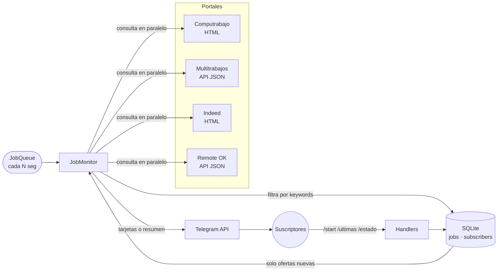

<div align="center">

# 🤖 BotTelegram Trabajos

**Recibe en Telegram las ofertas de empleo nuevas en cuanto se publican, sin duplicados.**

[](https://www.python.org/)
[](https://python-telegram-bot.org/)
[](https://www.sqlite.org/)
[](#-hoja-de-ruta)

[Características](#-características) ·
[Inicio rápido](#-inicio-rápido) ·
[Configuración](#%EF%B8%8F-configuración) ·
[Comandos](#-comandos) ·
[Arquitectura](#-arquitectura) ·
[Despliegue](#-despliegue)

</div>

---

## 📖 Descripción

**BotTelegram Trabajos** revisa periódicamente varios portales de empleo, filtra las ofertas según tus palabras clave y envía a sus suscriptores **solo las publicaciones nuevas**. Todas las ofertas vistas se guardan en SQLite, así que reiniciar el bot no repite avisos.

Está pensado para quien busca trabajo y no quiere entrar a cada portal varias veces al día. La configuración por defecto busca **ofertas de desarrollo de software en Quito, Ecuador**, y se puede cambiar a cualquier búsqueda o ciudad.

## ✨ Características

| | |
|---|---|
| 🔍 **Varios portales** | Computrabajo, Multitrabajos, Indeed y Remote OK, cada uno se activa o desactiva por separado |
| 🆕 **Solo lo nuevo** | Deduplicación persistente por enlace normalizado |
| 🎯 **Filtros** | Palabras clave para incluir y excluir, sin distinguir mayúsculas ni tildes |
| 🔗 **Avisos claros** | Tarjeta por oferta con botón *Ver oferta*; si llegan muchas a la vez, un solo resumen |
| 📋 **Consulta bajo demanda** | `/ultimas` muestra las ofertas más recientes en cualquier momento |
| 📊 **Estado** | Última y próxima revisión, y qué portales respondieron o fallaron |
| 🔕 **Control del usuario** | Menú con botones para pausar o reactivar los avisos |
| 🛡️ **Sin spam al arrancar** | La primera ejecución guarda las ofertas existentes sin enviarlas |
| 🧹 **Mantenimiento solo** | Quien bloquea el bot se elimina de la lista de suscriptores |
| ⚡ **Un solo proceso** | El bot y el monitor programado corren juntos y los portales se consultan en paralelo |

## 💬 Vista previa

Así se ve un aviso en Telegram:

```text
🆕 Desarrollador Full Stack Semi Senior
🏢 Santillana
📍 Quito, Pichincha
🌐 Multitrabajos
                         [ 🔗 Ver oferta ]
```

Así responde `/estado`:

```text
📊 Estado

🔔 Avisos: activados
🕒 Última revisión: hace 4 min
⏭ Próxima revisión: en 26 min
🗂 Ofertas registradas: 128

Portales (última revisión)
✅ Computrabajo — 14 ofertas
✅ Multitrabajos — 11 ofertas
⚠️ Indeed — bloqueado o sin respuesta (HTTP 403)
```

## 🚀 Inicio rápido

### Requisitos

- Python **3.10** o superior
- Un bot de Telegram creado con [@BotFather](https://t.me/BotFather)

### Instalación

```bash
git clone https://github.com/santy10e/BotTelegram_Trabajos.git
cd BotTelegram_Trabajos

python -m venv venv
# Windows
venv\Scripts\activate
# Linux / macOS
source venv/bin/activate

pip install -r requirements.txt
```

### Configurar y ejecutar

```bash
# Windows: copy .env.example .env
cp .env.example .env
```

Abre `.env`, pon tu token en `TELEGRAM_BOT_TOKEN` y ejecuta:

```bash
python main.py
```

Abre tu bot en Telegram y pulsa **Iniciar**. Listo. 🎉

> [!TIP]
> Para usar `/revisar` y ver el número de suscriptores, escribe `/estado`, copia tu `chat_id` y agrégalo a `ADMIN_CHAT_IDS` en `.env`.

## ⚙️ Configuración

Toda la configuración se lee de variables de entorno o del archivo `.env`.

| Variable | Descripción | Por defecto |
|---|---|---|
| `TELEGRAM_BOT_TOKEN` | Token de @BotFather. **Obligatorio.** | — |
| `ADMIN_CHAT_IDS` | `chat_id` de administradores, separados por coma | *(vacío)* |
| `SEARCH_QUERY` | Término de búsqueda | `desarrollador` |
| `SEARCH_CITY` | Ciudad | `quito` |
| `SOURCES` | Portales activos: `computrabajo`, `multitrabajos`, `indeed`, `remoteok` | `computrabajo,multitrabajos` |
| `KEYWORDS` | El título debe contener al menos una. Vacío = sin filtro | *(vacío)* |
| `EXCLUDE_KEYWORDS` | Descarta las ofertas cuyo título contenga alguna | *(vacío)* |
| `CHECK_INTERVAL_SECONDS` | Segundos entre revisiones (mínimo `300`) | `1800` |
| `DB_PATH` | Ruta de la base SQLite | `jobs.db` |
| `LOG_LEVEL` | `DEBUG`, `INFO`, `WARNING`, `ERROR` | `INFO` |

<details>
<summary><b>Ejemplo de <code>.env</code></b></summary>

```dotenv
TELEGRAM_BOT_TOKEN=123456789:tu-token-aqui
ADMIN_CHAT_IDS=111111111

SEARCH_QUERY=desarrollador
SEARCH_CITY=quito
SOURCES=computrabajo,multitrabajos

KEYWORDS=desarrollador,programador,developer,software,frontend,backend,full stack,devops,qa,data,python,java,.net
EXCLUDE_KEYWORDS=negocios,comercial,ventas

CHECK_INTERVAL_SECONDS=1800
```

</details>

## 🧭 Comandos

| Comando | Descripción |
|---|---|
| `/start` | Activa los avisos y muestra el menú principal |
| `/ultimas [n]` | Muestra las últimas *n* ofertas (por defecto 5, máximo 20) |
| `/estado` | Tu suscripción, las revisiones y la salud de cada portal |
| `/stop` | Pausa los avisos |
| `/ayuda` | Explica cómo funciona el bot |
| `/revisar` | 🔒 *Solo administradores.* Fuerza una revisión inmediata |

Alias en inglés: `/latest`, `/status`, `/help`. `/pausar` equivale a `/stop`.

## 🏗 Arquitectura



**Flujo de cada revisión**

1. El `JobQueue` lanza `JobMonitor.run()` en cada intervalo.
2. Cada portal se consulta en un hilo aparte (`asyncio.to_thread`); si uno falla, los demás siguen.
3. Las ofertas se normalizan (`Job.build`) y se filtran por palabras clave.
4. `INSERT OR IGNORE` sobre el enlace único deja pasar solo las ofertas nuevas.
5. Hasta 3 ofertas nuevas se envían como tarjetas sueltas; con más, se manda un solo resumen.

### Estructura del proyecto

```text
BotTelegram_Trabajos/
├── main.py                  # Punto de entrada: construye la app y programa el monitor
├── requirements.txt
├── .env.example             # Plantilla de configuración (sin secretos)
└── jobbot/
    ├── config.py            # Carga y valida .env
    ├── db.py                # Acceso a SQLite
    ├── models.py            # Modelo Job y normalización
    ├── monitor.py           # Revisión periódica y envío de avisos
    ├── handlers.py          # Comandos y botones de Telegram
    ├── messages.py          # Textos, formatos HTML y teclados
    └── fetchers/
        ├── __init__.py      # Registro de portales
        ├── base.py          # Utilidades HTTP/HTML compartidas
        ├── computrabajo.py
        ├── multitrabajos.py
        ├── indeed.py
        └── remoteok.py
```

## 🧩 Añadir un portal

1. Crea `jobbot/fetchers/miportal.py`:

   ```python
   from ..models import Job
   from .base import get_soup, text_of

   NAME = "Mi Portal"

   def fetch(query: str, city: str) -> list[Job]:
       soup = get_soup(f"https://miportal.com/empleos?q={query}&l={city}")
       jobs = []
       for card in soup.select(".oferta"):
           job = Job.build(
               title=text_of(card, "h2"),
               link=card.select_one("a")["href"],
               company=text_of(card, ".empresa"),
               location=text_of(card, ".ubicacion"),
               source=NAME,
           )
           if job:
               jobs.append(job)
       return jobs
   ```

2. Regístralo en `REGISTRY` dentro de `jobbot/fetchers/__init__.py`.
3. Agrega `miportal` a `SOURCES` en tu `.env`.

## 🖥 Despliegue

El bot usa *long polling*: no necesita un dominio, HTTPS ni puertos abiertos. Basta con un proceso que se mantenga corriendo.

<details>
<summary><b>Linux · systemd</b></summary>

`/etc/systemd/system/jobbot.service`:

```ini
[Unit]
Description=BotTelegram Trabajos
After=network-online.target

[Service]
WorkingDirectory=/opt/BotTelegram_Trabajos
ExecStart=/opt/BotTelegram_Trabajos/venv/bin/python main.py
Restart=on-failure
RestartSec=10

[Install]
WantedBy=multi-user.target
```

```bash
sudo systemctl enable --now jobbot
journalctl -u jobbot -f
```

</details>

<details>
<summary><b>Windows · NSSM</b></summary>

```powershell
nssm install JobBot "C:\ruta\BotTelegram_Trabajos\venv\Scripts\python.exe" main.py
nssm set JobBot AppDirectory "C:\ruta\BotTelegram_Trabajos"
nssm start JobBot
```

</details>

## 🔐 Seguridad

- El token **solo** vive en `.env`. Ese archivo, `jobs.db` (guarda los `chat_id` de los usuarios) y los entornos virtuales están en `.gitignore`.
- Los logs de `httpx` se silencian porque las URLs de la API de Telegram incluyen el token.
- Todo el texto que llega de los portales se escapa antes de enviarse como HTML.

> [!WARNING]
> Si tu token llega a publicarse, revócalo enseguida en @BotFather con `/revoke` y pon el nuevo en `.env`. Borrarlo del código no lo elimina del historial de git.

## 🛠 Solución de problemas

| Problema | Causa y solución |
|---|---|
| `Falta TELEGRAM_BOT_TOKEN` | No existe `.env` o la variable está vacía. Copia `.env.example` como `.env`. |
| No llegan avisos tras el primer arranque | Es lo esperado: la primera revisión guarda las ofertas existentes sin enviarlas. Usa `/ultimas` para verlas. |
| Un portal aparece con ⚠️ en `/estado` | El portal no respondió o cambió su HTML. Revisa los logs con `LOG_LEVEL=DEBUG`. |
| Indeed responde `HTTP 403` | Indeed bloquea las peticiones automáticas, por eso viene desactivado por defecto. |
| Llegan ofertas que no son del rubro | Ajusta `KEYWORDS` y `EXCLUDE_KEYWORDS`. |

## 🗺 Hoja de ruta

- [ ] Filtros y búsquedas propios para cada usuario
- [ ] Soporte para más ciudades y países
- [ ] `Dockerfile` y `docker-compose.yml`
- [ ] Pruebas automatizadas y CI con GitHub Actions
- [ ] Resumen diario opcional en lugar de avisos inmediatos

## 🤝 Contribuir

1. Haz un *fork* del repositorio.
2. Crea una rama: `git checkout -b feature/mi-mejora`.
3. Haz commit de tus cambios: `git commit -m "Agrega mi mejora"`.
4. Sube la rama: `git push origin feature/mi-mejora`.
5. Abre un *Pull Request*.

## ⚖️ Aviso

Este proyecto es solo para uso personal y educativo. Respeta los términos de uso de cada portal y no bajes demasiado el intervalo de revisión. Remote OK pide citarlo como fuente y enlazar a sus ofertas; el bot lo hace en cada aviso.

---

<div align="center">

Hecho por [@santy10e](https://github.com/santy10e) · Si te resulta útil, dale una ⭐

</div>
